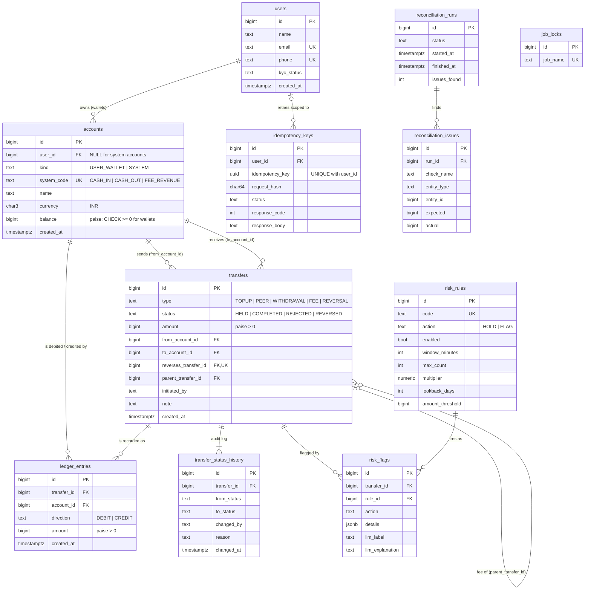

# Schema design

Designed from the requirements before any application code. Migrations:
[`V1__schema.sql`](../src/main/resources/db/migration/V1__schema.sql) (tables, constraints, triggers, indexes) and
[`V2__reference_data.sql`](../src/main/resources/db/migration/V2__reference_data.sql) (system accounts, risk
rules, job lock row). Flyway runs them on an empty database when the API starts.

## 1. Finding the tables: the noun list

Every noun in the requirements, and whether we need to store extra information about it.

| Noun (from the requirements) | Table? | Why |
|---|---|---|
| platform | no | There is exactly one; nothing to store about it. |
| **user** | **`users`** | Has its own attributes (name, email, phone, KYC status) and owns wallets. |
| name, email, phone, KYC status | no (columns) | Single-valued facts about a user → attributes of `users`. |
| **wallet** | **`accounts`** | Has attributes (owner, currency, balance) and is the target of ledger entries. |
| currency | no (column) | INR only; a `CHECK (currency = 'INR')` column, not a lookup table (YAGNI; add a `currencies` table when a second one arrives). |
| **system account** (cash-in, cash-out, fee revenue) | **`accounts`** (same table) | Behaves exactly like a wallet for the ledger: entries point at it, it has a balance. Stored with `kind = 'SYSTEM'` and a `system_code`. See README Q2. |
| **transfer** | **`transfers`** | The business event: type, status, amount, created time, who initiated it, optional note, link to the transfer it reverses. |
| transfer type | no (column + CHECK) | A fixed set of 5 values with no attributes of its own. |
| transfer status | no (column + CHECK) | Fixed set of 4 values; its **history** is a table (below). |
| amount | no (column) | `BIGINT` whole paise. |
| **ledger entry** (debit / credit) | **`ledger_entries`** | Many per transfer, each with its own account, direction and amount. |
| debit / credit | no (column) | `direction` column on `ledger_entries`. |
| reversal | no (self-reference) | A reversal *is* a transfer (`type = 'REVERSAL'`) pointing to the original via `reverses_transfer_id`. |
| balance | no (column) | Cached on `accounts.balance`; the truth is the sum of entries (see README Q1). |
| **idempotency key** | **`idempotency_keys`** | Must store user, key, request hash, status and the saved response. |
| statement | no | A query over `ledger_entries` (paginated, newest first), not stored. |
| **nightly job / report** | **`reconciliation_runs`** | One row per run: start, end, status, counts. |
| **mismatch** | **`reconciliation_issues`** | One row per problem found: check, entity, expected, actual. |
| job lock | **`job_locks`** | A row per job, locked with `FOR UPDATE NOWAIT` so only one run happens at a time. |
| **fraud rule** | **`risk_rules`** | Thresholds must live in data, not code. |
| flag / hold | **`risk_flags`** | Which rule fired on which transfer, evidence, plus the LLM explanation and label. |
| review (admin decision) | no (status change) | Release / reject is a status change on the transfer, recorded in the audit log with the admin as actor. |
| question (plain-English Q&A) | no | Answered on the fly from ledger rows; nothing needs to persist. |
| **audit log** of status changes | **`transfer_status_history`** | Who changed which transfer from which status to which, when, and why. |

## 2. Attributes

Every table has a system-generated `BIGINT GENERATED BY DEFAULT AS IDENTITY` primary key. Plural snake_case
table names, singular column names. All money columns are `BIGINT` paise.

| Table | Key attributes |
|---|---|
| `users` | `name`, `email` (unique, case-insensitive), `phone` (unique), `kyc_status`, `created_at` |
| `accounts` | `user_id` (nullable), `kind` (`USER_WALLET`/`SYSTEM`), `system_code` (unique, nullable), `name`, `currency`, `balance`, `created_at` |
| `transfers` | `type`, `status`, `amount`, `from_account_id`, `to_account_id`, `reverses_transfer_id` (unique), `parent_transfer_id`, `initiated_by`, `note`, `created_at`, `updated_at` |
| `ledger_entries` | `transfer_id`, `account_id`, `direction` (`DEBIT`/`CREDIT`), `amount` (> 0), `created_at` |
| `transfer_status_history` | `transfer_id`, `from_status`, `to_status`, `changed_by`, `reason`, `changed_at` |
| `idempotency_keys` | `user_id`, `idempotency_key` (UUID), `request_method`, `request_path`, `request_hash` (SHA-256), `status`, `response_code`, `response_body`, `created_at`, `completed_at` |
| `risk_rules` | `code`, `description`, `action` (`HOLD`/`FLAG`), `enabled`, `window_minutes`, `max_count`, `multiplier`, `lookback_days`, `amount_threshold` |
| `risk_flags` | `transfer_id`, `rule_id`, `action`, `details` (JSONB evidence), `llm_label`, `llm_explanation`, `explained_at` |
| `job_locks` | `job_name` (unique), `last_started_at`, `last_finished_at` |
| `reconciliation_runs` | `triggered_by`, `status`, `started_at`, `finished_at`, `checks_run`, `issues_found`, counts |
| `reconciliation_issues` | `run_id`, `check_name`, `entity_type`, `entity_id`, `expected`, `actual`, `details` |

## 3. Connecting the tables: cardinality

Each relationship was worked out from both sides; the foreign key goes on the "many" side.

| Relationship | One side → other side | Other side → one side | Cardinality | FK placement |
|---|---|---|---|---|
| user — wallet | a user has 0..many wallets | a wallet belongs to 1 user (system accounts: 0) | 1 : M (optional on the account side) | `accounts.user_id` (nullable for system accounts) |
| account — ledger entry | an account has 0..many entries | an entry is on exactly 1 account | 1 : M | `ledger_entries.account_id NOT NULL` |
| transfer — ledger entry | a transfer has 0 (held/rejected) or 2+ entries | an entry belongs to exactly 1 transfer | 1 : M | `ledger_entries.transfer_id NOT NULL` |
| account — transfer (payer) | an account sends 0..many transfers | a transfer has exactly 1 source | 1 : M | `transfers.from_account_id` |
| account — transfer (payee) | an account receives 0..many transfers | a transfer has exactly 1 destination | 1 : M | `transfers.to_account_id` |
| transfer — reversal | a transfer is reversed by at most 1 reversal | a reversal reverses exactly 1 transfer | 1 : 1 (optional) | `transfers.reverses_transfer_id UNIQUE` (either side would do; placed on the reversal, the side that is created later) |
| withdrawal — fee | a withdrawal has 0..many fee transfers | a fee belongs to 1 withdrawal | 1 : M | `transfers.parent_transfer_id` |
| transfer — status history | a transfer has 1..many status changes | a change is about 1 transfer | 1 : M | `transfer_status_history.transfer_id` |
| user — idempotency key | a user has many keys | a key belongs to 1 user (or none: `POST /users`, admin calls) | 1 : M | `idempotency_keys.user_id`, `UNIQUE NULLS NOT DISTINCT (user_id, idempotency_key)` |
| transfer — risk rule | a transfer can trip many rules | a rule can flag many transfers | **M : N** | mapping table **`risk_flags`** (`transfer_id`, `rule_id`, `UNIQUE (transfer_id, rule_id)`) carrying the evidence and LLM verdict |
| run — issue | a run finds 0..many issues | an issue belongs to 1 run | 1 : M | `reconciliation_issues.run_id` |

`transfers` → `accounts` is two separate 1:M relationships, not an M:N: each transfer has exactly one payer and one
payee, so two FKs on `transfers` model it directly. The ledger entries carry the general multi-leg form.

## 4. ER diagram

## 5. Letting the database protect us

| Invariant | Enforced by |
|---|---|
| Entry amounts are positive; direction stored separately | `ledger_entries.amount CHECK (amount > 0)`, `direction CHECK IN ('DEBIT','CREDIT')` |
| Each transfer's debits = credits | deferred constraint trigger `ledger_entries_balanced` (checked at COMMIT, because lines are inserted one at a time) |
| A user wallet never goes below zero | `accounts_wallet_non_negative_ck CHECK (kind = 'SYSTEM' OR balance >= 0)` |
| Ledger entries are insert-only | `BEFORE UPDATE OR DELETE` and `BEFORE TRUNCATE` triggers raise `restrict_violation` |
| Audit log is insert-only, and no status change escapes it | `transfer_status_history` append-only trigger; `transfers_status_audit` trigger writes a row on every insert / status update |
| A transfer is reversed at most once | `transfers.reverses_transfer_id UNIQUE` |
| Type and link agree | `CHECK ((type = 'REVERSAL') = (reverses_transfer_id IS NOT NULL))`, same for `FEE` / `parent_transfer_id` |
| Wallet vs system account shape | `accounts_owner_ck` (wallets have a user and no system code; system accounts the opposite) |
| An idempotency key is unique per user | `UNIQUE NULLS NOT DISTINCT (user_id, idempotency_key)` |
| INR only | `CHECK (currency = 'INR')` |
| Email / phone unique | unique indexes on `lower(email)` and `phone` |

These are all exercised by `TransferFlowTest` (raw SQL that tries to break each one).

## 6. Indexes for the real queries (and their write cost)

| Index | Query it serves |
|---|---|
| `ledger_entries (account_id, created_at DESC, id DESC)` | wallet statement, newest first; cursor pagination is a single index seek |
| `ledger_entries (transfer_id)` | entries of a transfer (`GET /transfers/{id}`, the commit-time balance trigger, reconciliation check 2) |
| `transfers (from_account_id, created_at) INCLUDE (amount, status)` | velocity and amount-spike rules, "my outgoing transfers" |
| `transfers (to_account_id, created_at)` | incoming side for Q&A "received" |
| `transfers (from_account_id, to_account_id)` | new-payee rule |
| `transfers (created_at) WHERE status = 'HELD'` | admin risk queue; partial, so it holds only the few HELD rows |
| `idempotency_keys (user_id, idempotency_key)` (the unique constraint) | the idempotency check itself |
| `idempotency_keys (created_at)` | nightly purge of keys older than 24h |

**Write cost.** Every transfer inserts 1 `transfers` row (5 indexes including the PK) and 2 `ledger_entries` rows
(3 indexes each), so about 11 index insertions per transfer. That is why there is **no** index on
`ledger_entries (direction)`, `ledger_entries (created_at)` or `transfers (status)`. The nightly checks scan
whole tables anyway (see [performance.md](performance.md)), and indexing for them would slow down every payment
to speed up one batch job a day. The partial HELD index is the exception that costs almost nothing, because
almost no rows qualify.
